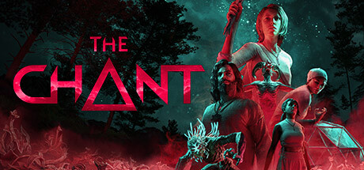

**The Chant is a supernatural horror game set on a remote spiritual retreat island where a dark ritual gone wrong opens a rift to a malevolent dimension. Features a unique Mind, Body, Spirit resource system tied to mental health and environmental fear.**

---

## 📖 About

The Chant is a supernatural horror game set on a remote spiritual retreat island where a dark ritual gone wrong opens a rift to a malevolent dimension. Features a unique Mind, Body, Spirit resource system tied to mental health and environmental fear.

## ⚠️ Problems Without Trainer

| Problem | Status |
|---------|--------|
| **Triple Resource Management** — Managing Mind, Body, and Spirit simultaneously creates constant tension | ✅ Solved |
| **Substance Crafting** — Prism essence items for combat must be carefully crafted from limited resources | ✅ Solved |
| **Rift Enemy Vulnerability** — Different enemy types require specific elemental damage approaches | ✅ Solved |
| **Sanity Pressure** — Spirit bar depleting triggers psychological breakdown limiting combat options | ✅ Solved |

## ✅ Solution

The **The Chant Trainer** solves all these issues by giving you complete control over the game.

## 🎯 Full Feature List

- Unlimited Resources
- God Mode / Invincibility
- Instant Skill Cooldown
- One-Hit Kill
- Freeze Game Timer
- Unlock All Items & Achievements
- Custom Speed Multiplier
- Save State Anywhere

## 🚀 Quick Start

1. **Disable Windows Defender** temporarily (trainer may trigger false positive)
2. Download the trainer from the button above
3. Launch The Chant
4. Run the trainer as Administrator
5. Activate desired cheats with hotkeys

## 💎 Free vs Paid

| Feature | Free | Pro |
|---------|------|-----|
| Basic God Mode | ✅ | ✅ |
| Unlimited Resources | ✅ | ✅ |
| All Advanced Cheats | ❌ | ✅ |
| Auto-Updates | ❌ | ✅ |
| Priority Support | ❌ | ✅ |

## 💻 Requirements

- Windows 10/11 (64-bit)
- The Chant (any version)
- .NET Framework 4.8+
- DirectX 11+

## 🍎 macOS

macOS users can use our alternative tool:

## ⚖️ Legal

This trainer is for educational and single-player use only. Use responsibly.

---

